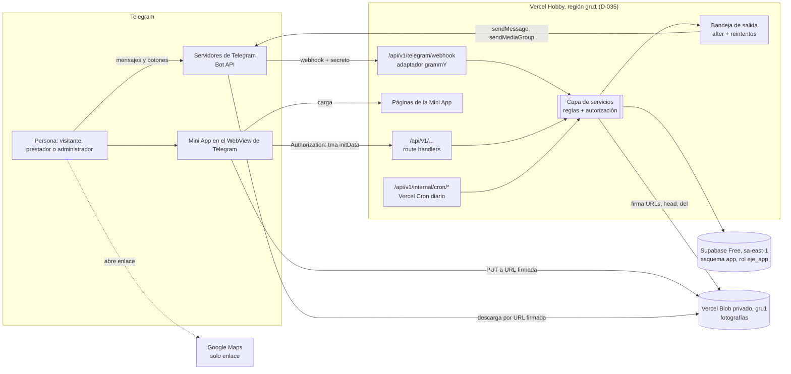
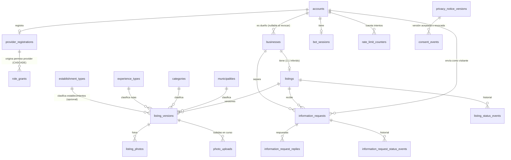

# Arquitectura: Eje Turismo

Fuentes: `docs/00-contexto-producto.md` (versión 1), `docs/01-brief.md`, `docs/02-requisitos.md`, `docs/05-aviso-privacidad.md`, `feature_list.json` (35 funcionalidades), `docs/guia-agentes.md` (sección architect) y el registro de decisiones congeladas D-001 a D-064. Stack y publicación fijos en `CLAUDE.md`. Contrato: `api/openapi.yaml` (versión 0.3.2, que agrega `GET /api/health` por D-061). Decisiones: `docs/adr/0001` a `docs/adr/0016`.

Fecha: 2026-11-14. Revisión: iteración 1 de preparación (`docs/04-readiness.md`), con D-034 a D-045 aplicadas, iteración 2, con D-046 a D-051 (hallazgos M-01 y M-16; D-047 no exige cambios de diseño), e iteración 3, con D-052 a D-058 y el hallazgo m-09 (D-056 y D-057 son textos del aviso y no exigen cambios de diseño). Marcas: **Confirmado** (contexto o decisión congelada), **Inferido** (requiere aprobación), **Pendiente** (falta información; lista al final). Las versiones y los límites de proveedores se verificaron en su documentación oficial y en el registro de npm el 2026-11-14. Las herramientas de la ADR 0014 están aprobadas (D-044). Revisión del 2026-11-15:
- D-062: TypeScript 5.x.
- D-063: base local con PostgreSQL de Homebrew, sin Docker.
- D-064: `/api/health` es solo prueba de vida.

## Visión general
Un solo proyecto Next.js en Vercel contiene la Mini App, la API HTTP y el webhook del bot. Los dos canales, bot y Mini App, son adaptadores delgados que llaman a una única capa de servicios, donde viven las reglas y la autorización (ADR 0001). La base de datos repite como restricciones los invariantes críticos (ADR 0002).



Reglas de la visión (Confirmado salvo indicación):
- El bot es solo interfaz; el backend concentra la lógica y la autorización (sección 3.11; guía de agentes).
- Funcionamiento independiente: ningún otro aplicativo es requisito, y Google Maps es solo un enlace (invariante 6; ADR 0016).
- Serverless: webhook en lugar de polling y sin disco local; la base de datos y las fotos están en servicios externos (sección 3.17; CLAUDE.md).
- El aviso de privacidad se acepta antes de cualquier uso, incluida la exploración, en el bot y en la Mini App (D-039).

## Componentes
| Componente | Responsabilidad | Tecnología | ADR |
| --- | --- | --- | --- |
| Adaptador del bot (`src/bot`) | Comandos, menús, botones, formularios conversacionales y textos en español. Construye el actor desde la actualización autenticada y llama a los servicios. Si la persona no tiene el aviso vigente, solo responde con el aviso (D-039) | grammY 1.x por webhook | 0001, 0008, 0015 |
| Webhook (`/api/v1/telegram/webhook`) | Verificar el secreto de Telegram, idempotencia por `update_id` para cuentas existentes, entregar la actualización a grammY | Next.js route handler, `webhookCallback(bot, 'std/http', { secretToken })` | 0003, 0008 |
| Mini App (`src/app/(miniapp)`, `src/miniapp`) | Aviso, inicio por rol, revocación, formularios largos de fichas y fotos (D-002), y municipios y listas cerradas del administrador (D-041) | Next.js 16 App Router, `telegram-web-app.js`, `openapi-fetch` | 0013 |
| API HTTP (`/api/v1/...`) | Validar la entrada (Zod), autenticar `initData`, construir el actor, llamar al servicio y mapear errores a `problem+json` | Next.js route handlers | 0003, 0006 |
| Salud (`/api/health`, `src/server/health.ts`) | Solo prueba de vida (D-064), pública y fuera de `/api/v1` (D-061): responde `{ status: "ok", timestamp }` sin autenticación, sin consultar la base ni Blob y sin guardar datos. No sustituye la verificación de Supabase ni de Blob | Next.js route handler (`force-dynamic`) | 0012, 0013 |
| Capa de servicios (`src/server/services`) | Casos de uso. Es la única puerta a los datos: verifica cuenta, aviso vigente, rol, negocio y permiso en cada operación, y abre las transacciones | TypeScript, Kysely | 0001, 0002 |
| Dominio (`src/server/domain`) | Reglas puras: transiciones de estado, campos obligatorios (D-003), límites (D-042), normalización de nombres, validación de enlaces de Maps, de solicitudes y del documento de identidad (`validateIdentityNumber`: tipo CC, CE, PPT o PA y número como texto, D-046), armado de mensajes del bot | TypeScript | 0002, 0004, 0008, 0016 |
| Autenticación (`src/server/auth`) | Validación HMAC de `initData`, construcción del actor, roles desde la base, administrador principal | `node:crypto` | 0003 |
| Acceso a datos (`src/server/db`) | Conexión por el pooler en modo transacción, transacciones con `set_config` del actor, tipos generados | Kysely 0.29 + `pg` 8 | 0012, 0014 |
| Almacenamiento de fotos (`src/server/storage`) | URLs firmadas de subida y lectura, verificación (`head` y firma de bytes), borrado | `@vercel/blob` 2.x (almacén privado) | 0009 |
| Notificaciones (`src/server/notifications`) | Bandeja de salida transaccional, envío después de responder y reintentos | `after()` de Next.js, grammY `Api` | 0007, 0008 |
| Tareas diarias (`src/server/jobs`) | Reintentos, mantenimiento y eliminación del 31 de enero de 2027 (D-043) | Vercel Cron | 0007 |
| Observabilidad (`src/server/observability`) | Logger estructurado con redacción de datos personales | TypeScript | 0005, 0006 |
| Base de datos | Persistencia, restricciones que protegen invariantes, disparadores de transición e historial | Supabase PostgreSQL | 0002, 0004, 0006 |
| Fotografías | Archivos de las fichas | Vercel Blob privado | 0009 |

## Modelo de datos
Todas las tablas están en el esquema `app`, que no se expone en la Data API, con RLS activo y una política solo para el rol `eje_app` (ADR 0006). Las claves primarias son `uuid` salvo indicación. Las fechas son `timestamptz` en UTC y se muestran en America/Bogota.



### Entidades
| Entidad | Campos principales | Restricciones que protegen invariantes | Fuente |
| --- | --- | --- | --- |
| `privacy_notice_versions` | `version` (PK, texto), `body_markdown`, `declaration_text`, `revocation_note`, `published_at`, `is_current` | Índice único parcial: una sola versión `is_current`. Texto aprobado (D-034), versión vigente "2026-11-v3"; `published_at` es el momento de la carga, y en producción es la fecha de vigencia (D-050) | Sección 3.15; D-025, D-034, D-050 |
| `accounts` | `id`, `telegram_user_id` (bigint, único), `telegram_display_name`, `consent_notice_version` (FK), `consent_accepted_at`, `consent_channel` (`bot`, `mini_app`), `created_at` | Solo existe tras aceptar el aviso (D-008). Se borra al revocar (D-019) y el 31 de enero de 2027 (D-043) | Secciones 2.3, 3.15 |
| `consent_events` | `id`, `event` (`accepted`, `revoked`), `channel`, `notice_version` (FK), `occurred_at` | **Sin identificador de la persona**: ni ID de Telegram, ni pseudónimo, ni cuenta, ni número de identidad (D-036). `eje_app` solo `INSERT`/`SELECT` | D-018, D-021, D-036 |
| `provider_registrations` | `id`, `account_id` (FK `ON DELETE CASCADE`), `identity_document_type` (enum `app.identity_document_type`: `CC`, `CE`, `PPT`, `PA`; `NOT NULL`), `identity_number_encrypted` (bytea), `identity_number_hash` (bytea), `status` (`pending`, `approved`, `rejected`), `created_at`, `decided_at`, `decided_by_account_id` (FK `SET NULL`), `rejection_reason` | El enum rechaza cualquier tipo fuera de D-046. Índices únicos parciales sobre `account_id` e `identity_number_hash` donde `status IN ('pending','approved')`; el hash cubre tipo y número normalizado (Confirmado: duplicado por tipo y número, D-054; normalización, D-055; ADR 0005). Disparador al insertar: rechaza si el `telegram_user_id` de la cuenta tiene un permiso `admin` activo (D-038, D-047) | HU-002, HU-003; D-011, D-038, D-046, D-047, D-054, D-055 |
| `role_grants` | `id`, `telegram_user_id` (bigint), `role` (`admin`, `provider`), `is_principal`, `provider_registration_id` (FK `ON DELETE CASCADE`), `granted_by_account_id` (FK `SET NULL`), `granted_at`, `revoked_at`, `revoked_by_account_id` (FK `SET NULL`) | Único parcial `(telegram_user_id, role) WHERE revoked_at IS NULL`; único parcial `WHERE is_principal AND revoked_at IS NULL`; CHECK `role='provider' ⇒ provider_registration_id NOT NULL`; CHECK `is_principal ⇒ role='admin'`; disparador: permiso `provider` solo con registro `approved` y sin `admin` activo para ese ID (D-038). Puede contener el ID de un administrador autorizado que aún no aceptó el aviso (D-037). Al borrar un registro se borran sus permisos (cascada) | Invariante 4; D-007, D-015, D-020, D-037, D-038 |
| `municipalities` | `id`, `name`, `name_normalized`, `department`, `general_info`, `zone` (opcional), `created_by`, `updated_by`, fechas | Único sobre `name_normalized` | HU-007; D-013, D-027 |
| `categories`, `experience_types`, `establishment_types` | `id`, `name`, `name_normalized`, `is_gastronomic` (solo tipos; por defecto falsa; solo lectura en la API, fijada por la semilla), responsables y fechas | Único sobre `name_normalized`. Listas cerradas: las fichas solo las referencian por FK (D-004, D-040). `establishment_types.is_gastronomic` es verdadera solo en restaurante y café (D-040). `experience_types.is_gastronomic` es verdadera solo en el tipo de experiencia gastronómica sembrado, "Sabores de Caldas", con UUID fijo (D-048, D-052; ADR 0011). `eje_app` no tiene privilegio de columna `INSERT` ni `UPDATE` sobre `is_gastronomic` | HU-008, HU-011; D-004, D-040, D-048, D-052 |
| `businesses` | `id`, `provider_account_id` (FK `accounts`, `ON DELETE SET NULL`), `owner_removed_at`, `created_at` | Unidad de separación de datos (invariante 2) | Sección 2.4; D-006, D-029 |
| `listings` | `id`, `kind` (`attraction`, `establishment`, `route_experience`), `business_id` (FK, único), `created_by_account_id` (FK `SET NULL`), `created_at` | CHECK `(kind='attraction') = (business_id IS NULL)` | ADR 0004; D-005 |
| `listing_versions` | `id`, `listing_id`, `version_number`, `status` (`draft`, `pending`, `published`, `rejected`, `superseded`), `name` (≤ 100), `name_normalized`, `municipality_id`, `category_id`, `establishment_type_id` (opcional), `experience_type_id`, `description` (≤ 1500), `schedule` (≤ 300), `contact` (≤ 200), `maps_url`, `guides_info`, `third_party_declared_at`, `submitted_at`, `submitted_by`, `decided_at`, `decided_by`, `rejection_reason`, fechas | Único parcial: una `published` por ficha; único parcial: una abierta (`draft`, `pending`) por ficha; exclusión de duplicados por municipio y nombre entre fichas distintas; CHECK de campos obligatorios en `pending` y `published`, que son exactamente los de D-003 más el tipo de experiencia en rutas (el tipo de establecimiento no se exige, D-040); CHECK de coherencia tipo/`kind`; CHECK de longitudes de D-042; CHECK `rejected ⇒ rejection_reason`; disparador de transiciones y de actor administrador | Invariante 3; D-003, D-024, D-040, D-042; ADR 0002 |
| `listing_photos` | `id`, `version_id` (FK `CASCADE`), `blob_pathname`, `content_type`, `size_bytes`, `position`, `telegram_file_id`, `uploaded_by`, `created_at` | Disparador con bloqueo de la versión: como máximo 10 por versión y suma de `size_bytes` hasta 2 GB (D-031). Solo en versiones editables: `draft` de una ficha de prestador, o `published` de un atractivo (administrador; F020, paso 7) | HU-017; ADR 0009 |
| `photo_uploads` | `id`, `version_id`, `requested_by_account_id` (FK `CASCADE`), `pathname`, `declared_size`, `content_type`, `expires_at`, `registered_at` | Cuenta para la cuota global mientras no vence | ADR 0009 |
| `listing_status_events` | `id`, `listing_id`, `version_id`, `from_status`, `to_status`, `actor_account_id` (FK `SET NULL`), `actor_role`, `reason`, `occurred_at` | Escrito por disparador en cada cambio de estado. `eje_app` solo `INSERT`/`SELECT` | HU-028; sección 3.12 |
| `information_requests` | `id`, `listing_id`, `business_id` (FK), `visitor_account_id` (FK `CASCADE`), `requester_name`, `interest_date` (date), `party_size`, `message`, `status` (`new`, `attended`, `closed`), fechas | CHECK `party_size > 0`; disparador de inserción: ficha con versión publicada, de negocio y con prestador con rol activo (D-029, D-043), fecha no pasada en America/Bogota; disparador de estado: solo `new→attended→closed` y actor dueño del negocio (invariante 5; D-044) | HU-024 a HU-026; D-010, D-011 |
| `information_request_replies` | `id`, `request_id` (FK `CASCADE`), `body`, `sent_by_account_id`, `sent_at` | Solo el dueño del negocio (servicio y disparador) | HU-026; D-010 |
| `information_request_status_events` | `id`, `request_id` (FK `CASCADE`), `from_status`, `to_status`, `actor_account_id`, `occurred_at` | Escrito por disparador | HU-026, criterio 2 |
| `notification_outbox` | `id`, `recipient_telegram_user_id`, `template`, `payload` (jsonb sin número de identidad), `status`, `attempts`, `next_attempt_at`, fechas | Se inserta en la misma transacción que la operación | ADR 0007 |
| `audit_events` | `id`, `occurred_at`, `actor_account_id` (FK `SET NULL`), `actor_role`, `action`, `entity_type`, `entity_id`, `details` (jsonb sin datos personales) | `eje_app` solo `INSERT`/`SELECT` | Sección 3.12 |
| `bot_sessions` | `account_id` (PK, FK `CASCADE`), `data` (jsonb), `updated_at` | Solo con el aviso vigente aceptado. El número de identidad solo va sellado (AES-256-GCM, con vencimiento), nunca en claro (ADR 0015) | ADR 0015 |
| `processed_updates` | `update_id` (bigint, PK), `received_at` | Idempotencia del webhook, solo para cuentas existentes. Sin ID de Telegram | ADR 0008 |
| `rate_limit_counters` | `account_id` (FK `accounts`, `ON DELETE CASCADE`), `action`, `window_start`, `count` | PK `(account_id, action, window_start)`. Sin IP ni ID de Telegram: solo cuentan personas que aceptaron el aviso (D-008, D-039) | ADR 0006 |
| `retention_settings` | `id` (único), `deadline` (date, 2027-01-31), `executed_at` | Lo lee la función de eliminación, que se ejecuta una sola vez | D-021, D-043; ADR 0007 |

Relaciones clave y por qué (guía de agentes, architect):
- **Prestador, negocio y ficha son distintos.** El prestador es una cuenta con permiso `provider`, el negocio es la unidad de separación y la ficha es el contenido (ADR 0004).
- **La versión publicada y la versión pendiente coexisten.** Editar nunca sobrescribe la versión publicada: crea o actualiza una versión `draft` (ADR 0004).
- **Atractivos sin negocio.** Los registra el administrador, se publican sin validación y no reciben solicitudes (D-005; regla aprobada en D-044).
- **Administrador y prestador no coexisten** en el mismo ID de Telegram (D-038, confirmada por D-047; ADR 0005).
- **El directorio gastronómico sale de dos marcas en las listas cerradas:** tipos de establecimiento restaurante y café (D-040) y el tipo de experiencia gastronómica sembrado, "Sabores de Caldas" (D-048, D-052). Ninguna ficha lleva una marca propia (ADR 0004).

## Autenticación, roles y autorización
Detalle en ADR 0003.

- **Bot:** Telegram llama al webhook con `X-Telegram-Bot-Api-Secret-Token`. Si falta la variable `TELEGRAM_WEBHOOK_SECRET`, la aplicación no arranca. El actor sale de `update.from.id` de una petición autenticada, nunca de `chat_id`.
- **Mini App:** cada petición lleva `Authorization: tma <initData>`, con validación HMAC-SHA256 oficial y vigencia de `auth_date` (valor por defecto 24 h, pendiente de aprobación). `initDataUnsafe` nunca se usa en el servidor. Una firma inválida responde 401 sin consultar la base ni registrar la IP.
- **Sin sesiones ni cookies.** Cada petición se autentica sola.
- **Actor:** `{ telegramUserId, accountId, consentVersion, roles, isPrincipalAdmin }`, construido en el backend. Los roles se leen de `role_grants` en cada operación, de modo que la revocación es inmediata (F006).
- **Administrador principal:** el ID fijado en `PRINCIPAL_ADMIN_TELEGRAM_ID` (D-007), llamado "administrador principal" en los textos (D-032). Nadie le puede revocar el rol (D-044) ni puede revocar su autorización (D-020).
- **Administradores autorizados:** su ID se guarda al autorizarlos, antes de que acepten el aviso (D-037). El permiso solo se usa cuando la persona acepta el aviso vigente.
- **Aviso vigente (D-008, D-025, D-039):** sin la versión vigente aceptada solo se puede leer el aviso, consultar `getMe`, aceptar y, si hay cuenta, revocar. Todo lo demás, incluida la exploración, responde 403 `consent_required`. En el bot, cualquier mensaje o botón de una persona sin cuenta, o con una versión anterior, recibe el aviso (B01).

### Matriz de permisos
| Operación | Sin cuenta | Cuenta con versión anterior del aviso | Visitante con aviso vigente | Registro pendiente | Prestador | Administrador |
| --- | --- | --- | --- | --- | --- | --- |
| Leer el aviso y aceptarlo | Sí | Sí | Sí | Sí | Sí | Sí |
| Explorar y ver fichas publicadas, municipios y listas | No: el bot y la Mini App muestran el aviso (D-039) | No: debe aceptar la versión nueva (D-025) | Sí | Sí | Sí | Sí |
| Revocar mi autorización | No (no hay datos) | Sí (HU-030, criterio 1; botón en B01 y M01 Inferido) | Sí | Sí | Sí | Sí, salvo el administrador principal o el único administrador (D-020) |
| Registrarse como prestador | No | No | Sí | No (duplicado) | No (duplicado) | No (D-038) |
| Enviar solicitud de información | No | No | Sí | Sí | Sí | Sí |
| Crear y editar fichas de su negocio, fotos, enviar a revisión | No | No | No | No | Solo de sus negocios | No (solo atractivos) |
| Ver y gestionar solicitudes | No | No | No | No | Solo de sus negocios | No (D-011) |
| Ver tipo y número de documento de identidad | No | No | No | No | No | Sí (D-011, D-046) |
| Autorizar o rechazar registros; autorizar administradores; "Revocar rol" | No | No | No | No | No | Sí |
| Municipios, categorías y tipos | No | No | Leer | Leer | Leer | Crear y editar en la Mini App (D-041) |
| Crear atractivos y sus fotos | No | No | No | No | No | Sí |
| Aprobar o rechazar fichas; historial | No | No | No | No | No | Sí |

La extensión `x-roles` de cada operación en `api/openapi.yaml` es la referencia por endpoint (`public`, `telegram_user`, `account_holder`, `consented_user`, `provider`, `admin`). `x-ownership` describe la verificación de negocio.

## Seguridad
Detalle en ADR 0005 y ADR 0006.

| Requisito del contexto | Cómo se cumple |
| --- | --- |
| Autenticación y autorización en el backend (sección 3.16) | `initData` firmado o secreto del webhook; actor y roles en el backend; los servicios son la única puerta; una regla de ESLint impide a los adaptadores importar la base |
| Verificar usuario, rol, negocio y permisos en cada operación (sección 3.11) | Cada servicio recibe el actor y comprueba aviso, rol y negocio. Los disparadores verifican que el actor sea administrador o dueño en las transiciones |
| Separación por negocio (sección 3.12) | Filtro por `businesses.provider_account_id`; 403 sin revelar existencia; FK y disparadores |
| Acceso solo a información autorizada; protección de datos personales (secciones 3.12 y 3.15) | Número de identidad cifrado (AES-256-GCM) en el registro y sellado en la sesión del bot; tipo de documento como enum sin cifrar (D-046). Los dos, solo visibles en la vista del administrador y redactados en el logger; datos de solicitudes solo para el dueño (D-011); esquemas de respuesta sin campos sensibles; logger con redacción; errores sin datos personales |
| Aviso aceptado antes de recolectar (invariante 7; D-008, D-039) | Sin cuenta no se escribe nada: ni sesión, ni contador, ni `processed_updates`. La única excepción es el ID de un administrador autorizado (D-037). Respuesta 403 `consent_required` |
| Prueba de autorización y revocación (D-036) | `consent_events` guarda solo evento, fecha, canal y versión |
| Validación y prevención de duplicados (sección 3.12) | Zod estricto en la API y en el bot; límites de D-042; tipo de documento de D-046 como enum en el contrato y en la base, y `validateIdentityNumber` en el dominio; índices únicos y restricción de exclusión en la base |
| Trazabilidad (sección 3.12) | `listing_status_events`, `information_request_status_events`, `audit_events`, decisiones de registro y permisos con fecha y responsable |
| Confirmación antes de operaciones importantes (invariante 8) | `confirmed: true` obligatorio en el cuerpo; el bot y la Mini App lo envían solo después de que la persona pulsa "Confirmar" |
| Credenciales fuera del repositorio (CLAUDE.md) | `.env` (no se lee ni se sube) y variables de Vercel; `.env.example` sin valores; validación al iniciar |
| Validar el origen de los datos de la Mini App (guía de agentes) | HMAC oficial, comparación en tiempo constante, vigencia de `auth_date` (F009) |
| Límites de intentos (ADR 0006) | Contadores en PostgreSQL **solo por cuenta** (`provider_registration`, `information_request`, `photo_upload`, `bot_update`). Quien no aceptó el aviso no tiene contador: está acotado por diseño (solo puede ver el aviso y aceptar) y por la mitigación DDoS de Vercel, disponible en todos los planes |
| Cabeceras, CORS y CSRF | CSP con `frame-ancestors` de Telegram, `nosniff`, `no-referrer` y HSTS; sin CORS (mismo origen); sin cookies, y por tanto sin CSRF |
| Base de datos no expuesta | Esquema `app` fuera de la Data API, Data API desactivada, RLS con política solo para `eje_app`; las claves `anon` y `service_role` no se usan |

### Mecanismo de cada invariante en el backend
| Invariante (CLAUDE.md) | Servicio y API | Base de datos | Verificación (QA) |
| --- | --- | --- | --- |
| 1. Verificación en cada operación | Actor desde una identidad verificada; roles por consulta; 401 y 403 | Rol `eje_app`, RLS, disparadores que comprueban el actor | F007, F008, F009 |
| 2. Separación por negocio | Filtro por el negocio del actor; 403 | FK a `businesses`; disparador de solicitudes | F016, F033 |
| 3. Solo el administrador aprueba; el visitante solo ve publicadas; la versión anterior sigue visible | Revisión solo para `admin`; consultas públicas solo de `published`; borrador separado | Únicos parciales, disparador de transiciones, CHECK de motivo y de campos | F014, F015, F022 |
| 4. Rol solo si el administrador autorizó el ID | Permiso `provider` solo al aprobar un registro; `admin` solo por autorización o configuración; administrador y prestador no coexisten (D-038) | CHECK y disparadores en `role_grants` y `provider_registrations` | F002, F003, F004, F007 |
| 5. Sin reservas ni pagos; solo el prestador cambia el estado | No existen endpoints de cupos ni pagos; cambio de estado solo del dueño | Enum y disparador de transiciones con actor dueño | F030, F032, F033 |
| 6. Funciona sola | Sin integraciones con otros aplicativos | — | Demostración completa con los componentes propios |
| 7. Ley 1581; aviso antes de recolectar; identidad no visible | 403 `consent_required` incluso para explorar (D-039); esquemas sin identidad; revocación transaccional | Sin cuenta no hay aceptación; contadores solo por cuenta; número cifrado y sellado; prueba sin identificador (D-036) | F001, F027, F034 a F037 |
| 8. Confirmación previa | `confirmed: true` obligatorio | — | Pasos de cancelación en F003, F006, F034, F036 |

## Publicación
Detalle en ADR 0012 y ADR 0010.

- **Vercel Hobby (D-035):** un proyecto Next.js con funciones Node.js 24.x y Fluid compute (máximo 300 s; cuerpo de petición máximo 4,5 MB), región única `gru1` (São Paulo) y Vercel Cron diario.
- **Supabase Free (D-035):** dos proyectos, desarrollo y producción, en `sa-east-1` (São Paulo). Free admite dos proyectos activos, no incluye copias automáticas y pausa el proyecto tras 7 días con poca actividad (documentación de Supabase, consultada el 2026-11-14). La aplicación se conecta por el pooler compartido en modo transacción (puerto 6543) con el rol `eje_app`. Las migraciones se aplican con la CLI de Supabase desde la máquina de la responsable.
- **Vercel Blob:** un almacén privado por entorno en `gru1`; la región no se puede cambiar después.
- **Telegram (D-035):** dos bots creados por la usuaria en BotFather. El de desarrollo se usa en local y en vista previa, y el de producción solo en producción. El webhook se registra con `pnpm bot:set-webhook`.
- **Entornos:** local (PostgreSQL 17 de Homebrew sin Docker, D-063; bot de desarrollo por polling local o túnel), vista previa (Supabase y Blob de desarrollo, bot de desarrollo) y producción.
- **Variables de entorno:** la lista completa está en la ADR 0012, y todas se validan al iniciar.

### Regiones y transferencia internacional (D-022, D-034, D-035)
| Proveedor | Región elegida | ¿En Colombia? |
| --- | --- | --- |
| Supabase (base de datos) | `sa-east-1`, São Paulo (Brasil) | No |
| Vercel Functions | `gru1`, São Paulo (Brasil) | No |
| Vercel Blob (fotos) | `gru1`, São Paulo (Brasil) | No |
| CDN de Vercel | Global (copias en caché) | No configurable por país |

Los datos se guardan y procesan fuera de Colombia. El aviso aprobado menciona la transferencia internacional (D-034).

### Límites de fotos (D-031, D-042)
| Límite | Valor | Cómo se verifica en QA |
| --- | --- | --- |
| Fotos por versión de ficha | 10 | Subir 11 fotos (F020, paso 3) |
| Tamaño por foto | 5 000 000 bytes | Subir una foto de más de 5 MB |
| Cuota global del almacén | 900 000 000 bytes en producción, configurable por entorno | En vista previa, bajar `BLOB_STORAGE_QUOTA_BYTES` y subir hasta superarla |
| Total por ficha | 2 GB, como regla de respaldo | No se alcanza con fotos reales (máximo 50 MB por ficha); lo cubre una prueba de integración con tamaños sintéticos |

Mecanismo de subida (ADR 0009): la Mini App pide una URL firmada `PUT` al backend (`createPhotoUpload`), que comprueba permisos y límites; sube el archivo directamente a Blob; y lo registra (`registerPhoto`). En ese momento el backend verifica el tamaño real y la firma de imagen y vuelve a comprobar los límites con bloqueo.

## Manejo de errores
- **Formato único en la API:** `application/problem+json` (RFC 9457) con `type`, `title`, `status`, `code` estable, `detail` en español y `errors[]` por campo. Esquema `Problem` en `api/openapi.yaml`.
- **Códigos HTTP:**
  - 401: sin identidad válida.
  - 403: sin permiso, recurso de otro negocio, `consent_required` o `admin_cannot_register_as_provider`.
  - 404: recurso inexistente.
  - 409: duplicado, transición inválida, `role_conflict`, regla protegida (`principal_admin_protected`, `last_admin_protected`, `listing_not_accepting_requests`) o límites de fotos.
  - 422: validación, `photo_too_large` o falta de `confirmed`.
  - 429: límite de intentos, solo para cuentas.
  - 500: error del sistema.
- **Errores de la base:** los servicios traducen `23505` (único), `23P01` (exclusión), `23514` (CHECK) y las excepciones de disparadores (`P0001` con código propio) a errores de dominio con `code` estable.
- **Bot:** cada error de dominio tiene un texto en español (`src/bot/texts/es.ts`). Ante una entrada inválida se repite solo el paso (HU-027). Ante un error del sistema responde "Ocurrió un error. Intenta de nuevo en unos minutos.", sin detalles técnicos ni datos personales. `/cancelar` y el botón "Cancelar" están en todo formulario.
- **Mini App:** muestra `detail` y marca los campos de `errors[]`. Si `initData` venció (401), pide reabrir la Mini App desde el bot (M12).
- **Registros técnicos:** sin tipo ni número de documento de identidad, sin `initData`, sin textos de solicitudes ni mensajes y sin datos de la sesión. Se registran el identificador interno de la cuenta, el código de error y un identificador de correlación.
- **Fallos de proveedores:** Telegram, con reintentos por la bandeja de salida (ADR 0007 y 0008); Blob, borrando el archivo si el registro falla, con la tarea diaria limpiando lo que quede sin referencia; base de datos, revirtiendo la transacción completa.

## Tareas programadas y en segundo plano
| Tarea | Cuándo se ejecuta | Qué hace | Fuente |
| --- | --- | --- | --- |
| Envío de mensajes de una operación | Inmediatamente después de responder (`after()`) | Envía las filas de `notification_outbox` creadas por la operación | ADR 0007; HU-025, HU-026, D-019, D-029 |
| Reintento de mensajes | Diario, `0 11 * * *` UTC (6:00 a 6:59 en Bogotá, Hobby) | Reintenta los mensajes con `next_attempt_at` vencido | ADR 0007 |
| Mantenimiento | Diario, `0 8 * * *` UTC (3:00 a 3:59 en Bogotá) | Borra de Blob los archivos sin referencia en `listing_photos`, las subidas vencidas, los contadores vencidos, los formularios del bot vencidos o abandonados y los `processed_updates` antiguos | ADR 0007, 0009, 0015 |
| Eliminación de datos (`runRetentionJob`) | Diario, `0 5 * * *` UTC (0:00 a 0:59 en Bogotá). Actúa una sola vez, el 31 de enero de 2027 o el primer día siguiente en que se ejecute | `app.purge_personal_data()` borra en una transacción cuentas, permisos, sesiones, contadores, consentimientos, registros, solicitudes con sus respuestas e historial, auditoría, historial de fichas, bandeja de salida, `processed_updates` y fichas de prestadores con sus versiones, fotos y negocios. Conserva municipios, listas cerradas, atractivos y el aviso. Marca `executed_at`. Las fotos borradas de Blob las elimina el mantenimiento | D-021, D-043; RNF-021; ADR 0007 |

Verificación de la eliminación (RNF-021): una prueba de integración con `deadline` en la fecha del día comprueba el alcance de D-043, lo conservado y que una segunda ejecución no cambia nada. Además, `pnpm purge:dry-run` informa qué se borraría en vista previa, y `pnpm purge:run` ejecuta la función contra la base de desarrollo con fecha simulada. La funcionalidad que la construye y la verifica es F038 (prioridad 12, depende de F037), con `runRetentionJob` y `runMaintenanceJob` (ver "Trazabilidad").

## Estructura de carpetas del código
Detalle en ADR 0013.
```
api/openapi.yaml
src/
  app/
    (miniapp)/                    pantallas de la Mini App
    api/health/route.ts           salud del backend, pública y sin versión (D-061)
    api/v1/**/route.ts            API HTTP
    api/v1/telegram/webhook/route.ts
    api/v1/internal/cron/{outbox,maintenance,retention}/route.ts
  bot/                            menús, formularios (forms/), textos (texts/es.ts)
  server/
    config/ auth/ services/ domain/ db/ storage/ notifications/ jobs/ observability/
  shared/api/schema.d.ts          generado desde api/openapi.yaml
  shared/api/client.ts            cliente openapi-fetch de la Mini App
  miniapp/                        componentes de la Mini App
supabase/
  config.toml
  migrations/                     SQL: tablas, restricciones, disparadores, roles, RLS, purge_personal_data
  seed/reference.sql, seed/demo.sql
  local/bootstrap.sql             solo local: roles que Supabase ya trae (ADR 0014, D-063)
scripts/                          set-webhook, bot-dev, notice-publish, purge-dry-run, purge-run
  db/                             bootstrap, migrate, seed, reset, test-clean con psql (ADR 0014)
tests/unit tests/integration tests/bot tests/e2e tests/factories
vercel.json                       crons y región gru1
.env.example                      nombres de variables sin valores
init.sh                           entorno y prueba de humo
```

## Herramientas y comandos
Versiones y alternativas en la ADR 0014 (aprobada en D-044 y revisada por D-062, D-063 y D-064). Los nombres de los scripts de `package.json` son contrato para `init.sh` y para los agentes.

- **Base local sin Docker (D-063):** PostgreSQL 17 de Homebrew (`postgresql@17`, la misma versión mayor que Supabase), con `btree_gist` y `unaccent`. Los roles que Supabase ya trae (`postgres` sin superusuario, `anon`, `authenticated` y `service_role`) los crea en local el script versionado `supabase/local/bootstrap.sql`. `eje_app` lo crea la migración, igual que en la nube (ADR 0006).
- **Migraciones:** en local se aplican con `psql` desde `supabase/migrations/`, sin `supabase db reset`. La CLI de Supabase se usa solo para `migration new` y `db push`.
- **Variables y bases:** las variables solo locales y el ciclo de vida de las bases de desarrollo y de prueba están en la ADR 0014.
- **TypeScript 5.x (D-062):** openapi-typescript 7.13.0 exige `^5.x`.

| Para qué | Herramienta | Comando |
| --- | --- | --- |
| Instalar dependencias | pnpm 10 (Corepack) | `pnpm install --frozen-lockfile` |
| Levantar o reiniciar el servidor de base local (manual, una vez) | PostgreSQL 17 de Homebrew (D-063) | `brew services start postgresql@17` / `brew services restart postgresql@17` |
| Comprobar el servidor y crear los roles locales | `psql` + `supabase/local/bootstrap.sql` | `pnpm db:bootstrap` |
| Aplicar migraciones pendientes en local | `psql` (historial en `supabase_migrations.schema_migrations`) | `pnpm db:migrate` |
| Cargar semillas en local | `psql` | `pnpm db:seed` |
| Recrear la base local de desarrollo con migraciones y semillas | `psql` | `pnpm db:reset` |
| Borrar bases temporales de prueba abandonadas | `psql` | `pnpm db:test:clean` |
| Crear una migración | CLI de Supabase (sin Docker) | `pnpm supabase migration new <nombre>` |
| Aplicar migraciones en un proyecto de Supabase en la nube | CLI de Supabase (sin Docker) | `pnpm db:push` (`supabase db push`, con `DATABASE_MIGRATIONS_URL`) |
| Cargar datos de referencia en producción | psql vía script | `pnpm db:seed:reference` |
| Generar tipos de la base | kysely-codegen | `pnpm db:types` |
| Generar tipos del contrato | openapi-typescript | `pnpm api:types` |
| Validar el contrato | @redocly/cli | `pnpm api:lint` |
| Verificar que los tipos coinciden con el contrato | openapi-typescript | `pnpm api:check` |
| Levantar backend y Mini App | Next.js | `pnpm dev` (puerto en `PORT`) |
| Bot en local | grammY (polling, solo local) | `pnpm bot:dev` |
| Registrar el webhook | grammY | `pnpm bot:set-webhook` |
| Publicar una versión del aviso | script | `pnpm notice:publish` |
| Simular la eliminación del 31 de enero de 2027 | script | `pnpm purge:dry-run`, `pnpm purge:run` (solo desarrollo) |
| Tipos y estilo | TypeScript, ESLint | `pnpm typecheck`, `pnpm lint` |
| Pruebas unitarias | Vitest | `pnpm test:unit` |
| Pruebas de integración (base temporal) | Vitest + PostgreSQL local | `pnpm test:integration` |
| Pruebas del bot | Vitest + grammY con la API interceptada | `pnpm test:bot` |
| Pruebas de extremo a extremo de la Mini App | Playwright | `pnpm test:e2e` |
| Todas las pruebas | Vitest y Playwright | `pnpm test` |
| Prueba de humo | Script | `./init.sh` (instala, `api:check`, `db:bootstrap`, `db:reset`, `typecheck`, `test:smoke`; si `pg_isready` falla, avisa y omite los pasos de base) |

## Pantallas
Canal según D-002: el bot lleva privacidad, registro, exploración, solicitudes y aprobaciones; la Mini App lleva los formularios largos de fichas y los catálogos del administrador (D-041). El catálogo de la Mini App para el visitante queda fuera de esta entrega (D-030). En los dos canales, la primera pantalla de quien no tiene el aviso vigente es el aviso (D-039).

| Id | Canal | Pantalla |
| --- | --- | --- |
| B01 | Bot | Aviso de privacidad con "Acepto" y "No acepto". Es la respuesta a cualquier mensaje o botón sin el aviso vigente (D-039). A cuentas con una versión anterior se les agrega "Revocar mi autorización" con la frase de D-023 (Inferido) |
| B02 | Bot | Menú inicial según el rol, con "Revocar mi autorización" y la frase de D-023. "Registrarme como prestador" solo para cuentas sin rol (HU-006, criterio 3; D-038) |
| B03 | Bot | Confirmación de revocación ("Sí, revocar" y "Cancelar") y resultado |
| B04 | Bot | Registro de prestador: tipo de documento con cuatro botones (CC, CE, PPT, PA; D-046), número de identidad (sellado en la sesión) y confirmación |
| B05 | Bot | Estado del registro pendiente |
| B06 | Bot | Menú de administrador ("Registros pendientes", "Autorizar administrador", "Revocar rol", "Fichas por revisar") |
| B07 | Bot | Registros pendientes: detalle con tipo y número de documento; "Autorizar" y "Rechazar" |
| B08 | Bot | Autorizar administrador: ingreso del ID y confirmación |
| B09 | Bot | "Revocar rol": lista de autorizados y confirmación |
| B10 | Bot | Fichas por revisar: detalle con los cambios respecto a la publicada; "Aprobar" y "Rechazar" con motivo |
| B11 | Bot | Historial de estados de una ficha |
| B12 | Bot | Menú de prestador: "Mis fichas" (estado y motivo) con un botón para abrir la Mini App |
| B13 | Bot | Solicitudes del prestador: lista por estado, detalle, "Responder", "Marcar atendida" y "Marcar cerrada" |
| B14 | Bot | Alerta de solicitud nueva con el botón "Atender" |
| B15 | Bot | Explorar: municipios, categorías y lista de fichas publicadas |
| B16 | Bot | Detalle de ficha: fotos, horarios, contacto, "Ver ubicación", "Solicitar información" (si aplica) y "Volver". Los datos de guías van en un segundo mensaje si no caben (ADR 0008) |
| B17 | Bot | Rutas y experiencias por tipo de experiencia |
| B18 | Bot | Directorio gastronómico: establecimientos de tipo restaurante o café (D-040) y experiencias del tipo de experiencia gastronómica sembrado, "Sabores de Caldas" (D-048, D-052) |
| B19 | Bot | Formulario de solicitud: nombre propuesto y editable, fecha, personas, mensaje y confirmación |
| B20 | Bot | Mensajes del sistema: resultado del registro y de la revisión, respuesta del prestador y avisos por revocación |
| B21 | Bot | Cancelación (`/cancelar`), entradas inválidas y errores |
| M01 | Mini App | Aviso de privacidad y declaración ("Acepto", "No acepto"; y "Revocar mi autorización" a cuentas con una versión anterior, Inferido) |
| M02 | Mini App | Inicio según el rol, con "Revocar mi autorización" y la frase de D-023 |
| M03 | Mini App | Confirmación de revocación y resultado |
| M04 | Mini App | Mis fichas (prestador) o fichas gestionadas (administrador) |
| M05 | Mini App | Formulario de ficha de prestador: establecimiento, con tipo opcional (D-040), o ruta y experiencia |
| M06 | Mini App | Fotos de la ficha: subir, ver los límites restantes y quitar |
| M07 | Mini App | Enviar a revisión: declaración de D-024 y confirmación |
| M08 | Mini App | Detalle de ficha gestionada: estado, motivo de rechazo, versión publicada y versión de trabajo |
| M09 | Mini App | Formulario de atractivo (administrador) |
| M10 | Mini App | Municipios (administrador; D-041) |
| M11 | Mini App | Categorías, tipos de experiencia y tipos de establecimiento (administrador; D-041) |
| M12 | Mini App | Mensajes de error y de sesión vencida |

## Trazabilidad
El bot no llama a la API por HTTP: usa el mismo servicio que el endpoint indicado (ADR 0001). Las funcionalidades retiradas por D-030 (F019, F025 y F026) no aparecen.

| Funcionalidad | Entidades | Endpoints (`operationId`) | Pantallas |
| --- | --- | --- | --- |
| F001 Aviso en el bot | `privacy_notice_versions`, `accounts`, `consent_events` | `getCurrentPrivacyNotice`, `acceptPrivacyNotice`, `getMe` | B01, B02 |
| F002 Registro de prestador | `provider_registrations`, `accounts`, `bot_sessions`, `rate_limit_counters`, `audit_events` | `createProviderRegistration`, `getMyProviderRegistration` | B04, B05, B21 |
| F003 Autorizar o rechazar registros | `provider_registrations`, `role_grants`, `audit_events`, `notification_outbox` | `listProviderRegistrations`, `approveProviderRegistration`, `rejectProviderRegistration` | B06, B07, B20 |
| F004 Administrador principal y autorizar administradores | `role_grants`, `accounts`, `audit_events` | `authorizeAdministrator`, `listRoleGrants`, `getMe` | B02, B06, B08 |
| F005 Menú según el rol sin repetir el registro | `accounts`, `role_grants`, `provider_registrations` | `getMe` | B02, B06, B12, M02 |
| F006 "Revocar rol" | `role_grants`, `audit_events` | `listRoleGrants`, `revokeRole` | B09 |
| F007 Sin rol no hay acciones de rol | `role_grants`, `accounts` | Todas las operaciones con `x-roles` `provider` o `admin` (por ejemplo, `approveListingVersion`, `createMunicipality`, `authorizeAdministrator`, `createListing`) responden 401 o 403 | B02 |
| F008 Prestador sin acciones de administrador | `role_grants` | `authorizeAdministrator`, `createMunicipality`, `createCategory` y `approveListingVersion` responden 403 | B12, M02 |
| F009 Firma de `initData` | — (validación sin estado) | Todas las operaciones con `telegramInitData`, empezando por `getMe` | M01 a M12 |
| F028 Cancelación y errores del bot | `bot_sessions` | `createProviderRegistration` (errores de validación) | B04, B21 |
| F034 Revocar mi autorización en el bot | `accounts`, `consent_events`, `bot_sessions`, `information_requests`, `notification_outbox` | `revokeMyAuthorization` | B01, B02, B03 |
| F035 Efectos de revocar para prestador y administrador | `provider_registrations`, `role_grants`, `businesses`, `consent_events` | `revokeMyAuthorization` | B03 |
| F036 Aviso y revocación en la Mini App | `privacy_notice_versions`, `accounts`, `consent_events` | `getCurrentPrivacyNotice`, `acceptPrivacyNotice`, `getMe`, `revokeMyAuthorization` | M01, M02, M03 |
| F010 Municipios | `municipalities`, `audit_events` | `listMunicipalities`, `createMunicipality`, `updateMunicipality` | M10, B15 |
| F011 Categorías y tipos de experiencia | `categories`, `experience_types`, `establishment_types`, `audit_events` | `listCategories`, `createCategory`, `updateCategory`, `listExperienceTypes`, `createExperienceType`, `updateExperienceType`, `listEstablishmentTypes`, `createEstablishmentType`, `updateEstablishmentType` | M11, M05 |
| F012 Atractivo del administrador | `listings`, `listing_versions`, `listing_status_events` | `createListing` (`attraction`), `listPublishedListings` | M09, B15 |
| F013 Ficha de establecimiento en borrador y envío a revisión | `businesses`, `listings`, `listing_versions`, `listing_status_events` | `createListing`, `saveListingDraft`, `submitListingForReview` (tipo de establecimiento opcional, D-040), `listManagedListings`, `getManagedListing` | M04, M05, M07, M08, B12 |
| F014 Aprobar o rechazar con motivo | `listing_versions`, `listing_status_events`, `notification_outbox` | `listPendingReviews`, `getReview`, `approveListingVersion`, `rejectListingVersion`, `getManagedListing`, `saveListingDraft`, `submitListingForReview` | B10, B12, B20, M08 |
| F015 Editar una ficha publicada sin ocultarla | `listing_versions`, `listing_photos` | `saveListingDraft`, `submitListingForReview`, `getReview`, `approveListingVersion`, `rejectListingVersion`, `getPublishedListing` | M05, M08, B10, B16 |
| F016 Separación de fichas entre prestadores | `businesses`, `listings` | `listManagedListings`, `getManagedListing`, `saveListingDraft`, `submitListingForReview` (403 para otro negocio) | M04, B12 |
| F029 Historial de una ficha | `listing_status_events` | `getListingStatusHistory` | B11 |
| F020 Fotografías y límites | `listing_photos`, `photo_uploads`, `listing_versions` | `createPhotoUpload`, `registerPhoto`, `removePhoto`, `getManagedListing`, `getPublishedListing` | M06, B16 |
| F021 Ubicación con Google Maps | `listing_versions` (`maps_url`) | `createListing`, `saveListingDraft`, `getPublishedListing` | M05, M09, B16 |
| F022 Explorar por municipio y categoría | `listing_versions`, `municipalities`, `categories` | `listMunicipalities`, `listCategories`, `listPublishedListings` | B15 |
| F023 Detalle de ficha en el bot | `listing_versions`, `listing_photos` | `getPublishedListing` | B16 |
| F018 Ruta o experiencia con guía como dato (prioridad 6) | `experience_types`, `listing_versions` (`guides_info`) | `createListing` (`route_experience`), `saveListingDraft`, `submitListingForReview`, `approveListingVersion` | M05, M07, B15, B16 |
| F017 Restaurante, café o experiencia gastronómica (prioridad 7; depende de F014 y F018, D-058) | `establishment_types`, `experience_types` ("Sabores de Caldas", D-048, D-052), `listings`, `listing_versions` | `listEstablishmentTypes`, `listExperienceTypes`, `createListing` (`establishment` y `route_experience`, esta última construida en F018), `submitListingForReview`, `approveListingVersion`, `listPublishedListings` (`gastronomic=true`) | M05, M07, B18 |
| F024 Filtrar por tipo de experiencia | `experience_types`, `listing_versions` | `listExperienceTypes`, `listPublishedListings` (`kind=route_experience`, `experienceTypeId`) | B17 |
| F027 Número de identidad nunca visible al visitante | `provider_registrations`, `bot_sessions` | `getPublishedListing`, `listPublishedListings`, `getManagedListing` (sin tipo ni número de documento); errores de `createProviderRegistration` | B16, B04 |
| F030 Enviar solicitud | `information_requests`, `rate_limit_counters` | `createInformationRequest` | B01, B16, B19 |
| F031 Alerta al prestador | `notification_outbox` | `createInformationRequest` (encola la alerta) | B14 |
| F032 Responder y cambiar el estado | `information_requests`, `information_request_replies`, `information_request_status_events`, `notification_outbox` | `listMyBusinessInformationRequests`, `getInformationRequest`, `replyToInformationRequest`, `changeInformationRequestStatus` | B13, B14, B20 |
| F033 Solicitudes solo para el prestador del negocio | `information_requests` | `getInformationRequest`, `changeInformationRequestStatus` (403 para otros) | B13 |
| F037 Efectos de revocar sobre solicitudes y fichas | `information_requests`, `notification_outbox`, `businesses`, `listing_versions` | `revokeMyAuthorization`, `getPublishedListing` (`acceptsRequests=false`), `createInformationRequest` (409) | B03, B16, B20 |
| F038 Eliminación de datos del 31 de enero de 2027 (RNF-021) | Todas las del alcance de D-043, `retention_settings` | `runRetentionJob`, `runMaintenanceJob` (borra de Blob las fotos de las fichas eliminadas) | Vercel Cron; `pnpm purge:dry-run`, `pnpm purge:run` (sin pantalla) |

## Riesgos técnicos
| Riesgo | Impacto | Mitigación |
| --- | --- | --- |
| Capacidad: 35 funcionalidades hasta el 26 de noviembre de 2026 (D-026) | Puede no terminarse a tiempo | Capa de servicios y migraciones primero; F001, F002 y la autorización (prioridad 1) antes de cualquier ficha; el mismo servicio sirve al bot y a la Mini App |
| F017, paso 5, crea una ficha `route_experience`, capacidad que construye F018 | El developer tendría que construir parte de F018 dentro de F017, o QA no podría cerrar el paso | Resuelto por D-058: F017 depende de F018, que pasa a prioridad 6, y F017 pasa a prioridad 7. Sin cambios de diseño |
| El administrador renombra "Sabores de Caldas" en M11 | El nombre visible deja de ser el de D-052 | La marca `is_gastronomic` y el UUID no cambian, así que la ficha sigue en el directorio; la semilla no sobrescribe filas existentes (ADR 0011). Cambiar el nombre aprobado es decisión de la usuaria, no del sistema |
| El tipo de documento PPT revela la situación migratoria | Exposición de un dato delicado si se filtra la base | Solo lo ven administradores, no está en esquemas públicos ni de prestador y el logger lo redacta (ADR 0005) |
| Hobby de Vercel Blob: 1 GB incluido; si se supera, Blob queda inaccesible 30 días | El bot deja de mostrar fotos | Cuota global de 900 MB y 5 MB por foto (D-042) |
| Telegram no acepta descargar una URL firmada de Blob | Fichas sin fotos en el bot | Respaldo: la función descarga la foto y la sube como archivo (hasta 10 MB); `file_id` guardado para reenvíos |
| Subida de archivos desde el WebView de Telegram en distintos clientes (iOS, Android, Telegram Web) | Algunas personas no pueden subir fotos | Probar en los tres clientes al inicio de F020; `<input type="file" accept="image/jpeg,image/png">` estándar |
| grammY acepta todas las peticiones si `secretToken` no está definido | Webhook abierto a actualizaciones falsas | La validación del entorno impide arrancar sin `TELEGRAM_WEBHOOK_SECRET`; una prueba envía una petición sin cabecera y espera 401 |
| Pooler de Supabase en modo transacción: sin sentencias preparadas con nombre ni estado de sesión | Errores intermitentes o actor no registrado en los disparadores | `pg` sin sentencias con nombre; `set_config(..., true)` dentro de cada transacción; pruebas contra el pooler en desarrollo |
| Supabase Free pausa el proyecto tras 7 días con poca actividad | Falla la demostración, o la eliminación no corre el 31 de enero de 2027 | Abrir el proyecto o usar el bot antes de la demostración y en los días previos al 31 de enero; la eliminación corre el primer día en que el proyecto esté activo |
| Copias del proveedor después del 31 de enero de 2027 | Datos retenidos fuera del plazo | Supabase Free no tiene copias automáticas (página de precios, 2026-11-14); las copias internas del proveedor no están documentadas por proyecto |
| Registros de plataforma de Vercel (IP y metadatos de las peticiones) | Datos técnicos de personas que no aceptaron, fuera del control de la aplicación | La aplicación no los escribe ni los lee; su retención la fija el proveedor. Se informa a la usuaria |
| `PRINCIPAL_ADMIN_TELEGRAM_ID` en las variables de Vercel | Dato personal que la función de eliminación no borra | La responsable lo quita o lo cambia a mano al llegar el plazo |
| Precisión horaria de Vercel Cron en Hobby (±59 min) y una ejecución al día | Reintentos de mensajes lentos | Envío inmediato con `after()` y reintento diario |
| Vercel anuncia la migración de Cron Jobs a "Schedules" | Cambio de configuración futuro | Las tareas son endpoints protegidos; solo cambia la programación |
| Pérdida de `IDENTITY_ENCRYPTION_KEY` | Números de identidad ilegibles | La responsable guarda la clave también fuera de Vercel; rotación documentada |
| La base local (PostgreSQL 17 de Homebrew, D-063) no replica el pooler, el SSL ni los roles internos de Supabase | Un error que solo aparece en la nube no se detecta en local | Roles de Supabase simulados por `supabase/local/bootstrap.sql`; misma versión mayor; cada migración va primero al proyecto de desarrollo (`pnpm db:push`); pruebas contra el pooler de desarrollo (ADR 0014) |
| Que `supabase db push --db-url` funcione sin Docker es Inferido (respuesta de un mantenedor de la CLI; la documentación solo dice que `db diff`, `db pull` y `db dump` necesitan Docker) | No se podría migrar la nube con la CLI | Comprobarlo con el primer `db push` al proyecto de desarrollo; si falla, `db:push` pasa a ser un script con `psql` sobre el mismo historial, sin cambiar el nombre del comando |
| La versión real de los dos proyectos de Supabase no está comprobada | Si fueran de la versión 15, la local (17) no coincidiría | Pendiente 7: ejecutar `SHOW server_version;` en cada proyecto y, si no es 17, cambiar la fórmula de Homebrew y `major_version` de `supabase/config.toml` |
| D-044 aprueba en bloque las reglas Inferidas del antiguo Pendiente 22, que incluía "un administrador también puede registrarse como prestador" | Contradecía D-038 | Resuelto por D-047: vale D-038. Sin cambios de diseño |

## Pendientes
Resueltos en la iteración 1 y retirados: regiones y transferencia (D-034, D-035), límites de fotos y de caracteres de la ficha (D-042), prueba sin pseudónimo (D-036), ID del administrador antes de aceptar (D-037), alcance de la eliminación y efectos de "Revocar rol" (D-043), canal de catálogos (D-041), tipos de establecimiento y directorio (D-040), planes y bots (D-035), reglas Inferidas del antiguo Pendiente 22 (D-044; la del administrador como prestador queda resuelta por D-038) y herramientas de la ADR 0014 (D-044).

Resueltos en la iteración 2: formato del documento de identidad (D-046, cierra D-045), experiencias gastronómicas en el directorio (D-048), administrador como prestador (D-047 confirma D-038), versión del aviso (D-050) y criterio para el plazo posterior al 31 de enero de 2027 (D-051; Pendiente 3).

Resueltos en la iteración 3 y retirados (la lista se renumeró):
- Nombre del tipo de experiencia gastronómica: "Sabores de Caldas" (D-052). La semilla lo carga en todos los entornos, incluida producción, y desaparecen el marcador y la regla de omitir la fila en producción (D-053; ADR 0011). Era el antiguo Pendiente 1.
- Regla de duplicado del documento de identidad: compara tipo y número (D-054; ADR 0005). Era el antiguo Pendiente 4. Su nota relacionada también queda resuelta: el aviso, apartado 2, dice "tu tipo y número de documento de identidad" dentro de la versión "2026-11-v3" (D-056).
- De la lista de valores técnicos por defecto (antes número 8), los cuatro valores del documento de identidad (D-055): normalización del número (sin espacios al inicio ni al final y con las letras en mayúsculas; sin quitar puntos ni espacios internos), nombres visibles de los tipos (cédula de ciudadanía, cédula de extranjería, Permiso por Protección Temporal y pasaporte), sigla aceptada en minúsculas en el bot y máximo técnico de 4096 caracteres en el número. Los demás valores de ese Pendiente no los cubre D-055 y siguen abiertos (Pendiente 6).
- Dependencia de F017 respecto de F018 y prioridades (D-058).
- Texto del aviso, apartado 2.5 (D-057): sin efecto en la arquitectura; se carga con la semilla del aviso.

Equivalencia de la numeración anterior: antiguo 2 → 1, 3 → 2, 5 → 3, 6 → 4, 7 → 5 y 8 (valores no cubiertos por D-055) → 6.

**Bloquea el cierre en QA:** ninguno.

**Abiertos, no bloquean la construcción; cada uno lleva un valor por defecto que aplica el código hasta que la usuaria decida:**

1. **Autorizar como administrador a un prestador activo o a alguien con registro pendiente.** D-038 solo prohíbe el caso contrario. Por defecto, 409 `role_conflict` (Inferido; ningún paso de F004 lo prueba).
2. **"Revocar mi autorización" para cuentas con una versión anterior del aviso.** La API lo permite (HU-030, criterio 1). Por defecto, el botón aparece en B01 y M01 junto al aviso nuevo, y "No acepto" no cambia nada de lo guardado (Inferido).
3. **Plazo de conservación de los datos recogidos después del 31 de enero de 2027 (D-051).** La eliminación se ejecuta una sola vez, y el aviso solo habla de esa fecha. El plazo se decide antes de esa fecha; si el sistema sigue en uso, se publica una versión nueva del aviso con el plazo nuevo y se ajusta la tarea (ADR 0007). Mientras tanto, después de ejecutarse no vuelve a borrar. No bloquea la entrega.
4. **Límites de caracteres de los campos que no cubre D-042** (datos de guías, nombres de municipios y de listas, información general del municipio, nombre y mensaje de la solicitud, motivos de rechazo). Por defecto, un máximo técnico de 4096 caracteres; el bot divide los mensajes si hace falta. No incluye el número de documento, cuyo máximo técnico aprobó D-055.
5. **Contenido de las semillas.** Categorías y tipos de experiencia iniciales, distintos de "Sabores de Caldas" (D-052), y datos de demostración. Por defecto no hay ninguno, y el administrador los crea en M11.
6. **Valores técnicos por defecto que D-055 no cubre, para aprobar en conjunto:**
   - "Usuario eliminado" como responsable en la trazabilidad tras revocar o tras la eliminación.
   - Nuevo registro permitido tras un rechazo (la unicidad solo cuenta registros pendientes o aprobados).
   - Vigencia de `initData` de 24 h.
   - Límites de intentos por cuenta: registro de prestador, 5 por hora; solicitudes, 10 por día; URLs de subida, 30 por hora; actualizaciones del bot, 30 por minuto.
   - Normalización de nombres para duplicados (sin mayúsculas, tildes ni espacios repetidos).
   - Formatos JPEG y PNG.
   - Sin acceso del administrador a borradores de prestadores.
   - Edición de atractivos publicados fuera de esta entrega, salvo las fotos.
   - Vigencia de 10 minutos del número de identidad sellado en la sesión del bot.
7. **Base local sin Docker (D-063; ADR 0014).** Detalles que aplica el developer hasta que la usuaria decida:
   - **Versión de PostgreSQL:** por defecto, la 17 (`postgresql@17`), la predeterminada en Supabase y la de `major_version` en `supabase/config.toml`. Falta confirmarla en los dos proyectos con `SHOW server_version;`.
   - **Autenticación local:** por defecto, `trust` solo en `localhost`, como lo deja Homebrew. Así no hay contraseñas locales, y las URL locales de la ADR 0014 no llevan secretos (Inferido).
   - **Contraseña de `eje_app` en la nube:** la fija la responsable una vez por proyecto, fuera del repositorio, y solo queda en `DATABASE_URL` en Vercel. No va en ninguna migración (Inferido).
   - **Nombres de scripts y variables:** `db:bootstrap`, `db:migrate`, `db:seed`, `db:reset`, `db:test:clean`, `LOCAL_PG_SUPERUSER_URL`, `LOCAL_DB_NAME`, `LOCAL_DATABASE_MIGRATIONS_URL` y `PG_BIN`. Son propuesta del architect.
